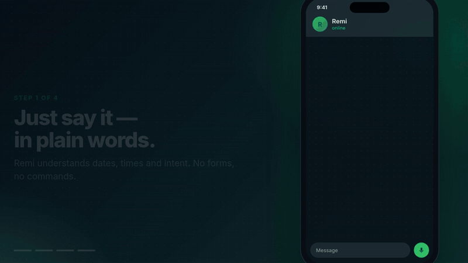
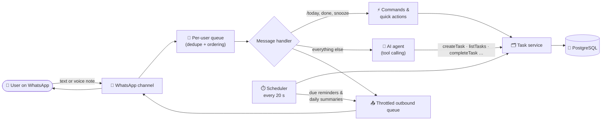

<div align="center">



<a href="#-quick-start"></a>

<p>
  <a href="https://github.com/Taha493/WhatsAppBot/actions/workflows/ci.yml"></a>
  
  
  
</p>
<p>
  
  
  
  
  
  
</p>

**[The problem](#-the-problem) · [The solution](#-the-solution) · [Features](#-features) · [How it works](#%EF%B8%8F-how-it-works) · [Quick start](#-quick-start) · [Usage](#-using-remi) · [Deploy](#%EF%B8%8F-run-it-247)**

<br>



</div>

---

## 🧩 The problem

Staying organised shouldn't take three apps and a sticky note.

| | |
|---|---|
| 🗂️ **Tasks get scattered** | Notes apps, calendars, paper — nothing is in one place, so things slip. |
| 🔕 **Reminders get missed** | A notification from yet another app is easy to swipe away and forget. |
| 🔀 **Too much friction** | Opening a separate tool, tapping through forms and date pickers for every small task kills the habit. |

Meanwhile, there's one app almost everyone already checks dozens of times a day: **WhatsApp**.

## 💡 The solution

**Remi** is an AI personal secretary that lives in WhatsApp. You talk to it the way you'd text a friend — typed or as a voice note — and it turns that into tasks, reminders and plans, then **messages you when something is due**.

```text
You:  Remind me to submit my assignment tomorrow at 10 AM.
Remi: Done! ✅ I'll remind you tomorrow at 10:00 AM ⏰

You:  What do I have to do this week?
Remi: 📋 Next 7 days
      #1 Submit assignment — tomorrow, 10:00 AM ⏰
      #2 Prepare project presentation — Thursday
      #3 Review portfolio — Friday

                       — next day, 10:00 AM —
Remi: ⏰ Reminder: Submit assignment
You:  ↳ done
Remi: ✅ Marked "Submit assignment" as done. Great job!
```

No new app to install, no forms, no commands to memorise.

## ✨ Features

<table>
<tr>
<td width="50%" valign="top">

### 🧠 Understands plain language
Relative dates (*"next Friday"*, *"in 2 hours"*), references (*"the assignment"*), corrections (*"actually make it 11"*) and multiple tasks in one message.

### ⏰ Smart, reliable reminders
Exact or relative (*"3 hours before"*), delivered within ~20 s and **never twice**. Reply to a reminder with **done**, **snooze 1h** or **tomorrow**.

### 🎤 Voice notes
Speak instead of typing — notes are transcribed with Whisper and handled like text.

### 🔁 Recurring tasks
*"Every Monday at 9 AM"* — repeats correctly, even across daylight-saving changes.

</td>
<td width="50%" valign="top">

### ☀️ Daily summary
An optional morning digest of today's and overdue tasks, at the time each user chooses.

### ↩️ History & undo
Every change is logged: *"what did I finish last week?"*, and `/undo` reverts the last change.

### 🌍 Timezone-aware
Guessed from the phone number, confirmed with the user, stored in UTC.

### 📊 Admin dashboard
Connection status, users, conversations (including the AI's tool calls) and the reminder delivery log.

</td>
</tr>
</table>

> [!TIP]
> `/today`, `/week`, `/done 3` and reminder replies work **without the AI**, so the essentials keep working even when free AI quotas run out.

## ⚙️ How it works



1. **A message arrives** and is de-duplicated and queued, so each user's messages are handled in order.
2. **Simple things skip the AI**: commands and replies to reminders are handled directly.
3. **Everything else goes to the AI agent**. It sees the user's local time, a 14-day calendar and their open tasks, and calls typed tools (`createTask`, `updateTask`, `completeTask`, …). The server validates every call before anything is saved.
4. **The scheduler** claims due reminders in a single database transaction (`FOR UPDATE SKIP LOCKED`), sends them, and remembers the message id so a quote-reply like *"done"* knows which task it's about.

### 🛠️ Engineering highlights

| Challenge | How Remi handles it |
|---|---|
| LLMs are bad at date arithmetic | The model gets a 14-day calendar and writes **local** times; the server converts to UTC with Luxon. |
| Free AI tiers rate-limit and go down | A **fallback chain** of models (Groq → Groq → Gemini) with retry-after handling and a 45 s budget. |
| A model failing halfway could duplicate tasks | Once anything is saved, Remi never retries on another model — it confirms what was saved instead. |
| Reminders must not be sent twice | Atomic claiming, retries with limits, and catch-up for reminders missed during downtime. |
| The model inventing task IDs | Tasks have short per-user numbers (`#3`) that the model can see. |
| Messaging-platform lock-in | The core talks to a small `Channel` interface; the same app runs in the terminal (`pnpm chat`) and in tests. |

## 🚀 Quick start

> **Requirements:** Node.js 22+ (24 recommended), pnpm, a free [Groq](https://console.groq.com/keys) API key, and a spare phone number with WhatsApp (or WhatsApp Business) for the bot.

```bash
git clone https://github.com/Taha493/WhatsAppBot.git remi && cd remi
pnpm install
cp .env.example .env        # then add your keys (see below)
```

**1 · Try it in the terminal first — no phone needed:**

```bash
pnpm chat
```

**2 · Connect WhatsApp:**

```bash
pnpm dev
```

A QR code appears in the terminal (and at `http://localhost:3000/link` if `ADMIN_PASSWORD` is set). On the bot's phone open **WhatsApp → Linked devices → Link a device** and scan it. Then message the bot's number from your own WhatsApp. The session is stored in the database, so restarts don't need a new scan.

<details>
<summary><b>⚙️ Configuration (<code>.env</code>)</b></summary>

<br>

| Variable | Required | Description |
|---|---|---|
| `GROQ_API_KEY` | ✅ | Free key from [Groq](https://console.groq.com/keys). Main AI model and voice notes. |
| `GOOGLE_GENERATIVE_AI_API_KEY` | recommended | Free key from [Google AI Studio](https://aistudio.google.com/apikey). Last fallback model. |
| `DATABASE_URL` | for 24/7 | Postgres URL, e.g. Supabase → *Connect* → **Session pooler**. Empty = embedded local database in `.data/`. |
| `ADMIN_PASSWORD` | recommended | Enables `/admin` and `/link` (user `admin`). |
| `LLM_PRIMARY` / `LLM_FALLBACK` | – | Default `groq:openai/gpt-oss-120b`, fallbacks `groq:openai/gpt-oss-20b,google:gemini-3.5-flash`. |
| `WA_LINK_METHOD` | – | `qr` (default) or `pairing` (enter a code instead; set `WA_PAIRING_PHONE`). |
| `WA_ALLOWLIST` | – | Comma-separated numbers allowed to use the bot. Empty = anyone. |
| `DEFAULT_TIMEZONE` | – | Used when the timezone can't be guessed (default `Asia/Karachi`). |

</details>

## 💬 Using Remi

Just talk to it. Some things to try:

| Say… | Remi… |
|---|---|
| *Remind me to call mom at 6pm* | creates the task with a reminder |
| *I need to prepare slides for Thursday, high priority* | creates a dated, high-priority task |
| *My flight is Friday at 6pm, remind me 3 hours before* | sets a relative reminder |
| *Every Monday at 9 remind me to plan the week* | creates a recurring task |
| *Move the presentation to Friday* | reschedules (reminders move too) |
| *What's overdue?* · *What did I finish last week?* | lists tasks / history |
| *I'm in London* · *Send me a summary every morning at 8* | updates settings |
| 🎤 a voice note | transcribes it and acts on it |

| Shortcut | What it does |
|---|---|
| `/today` · `/week` · `/tasks` | Today's tasks · next 7 days · all open tasks |
| `/done 3` · `/undo` | Complete task #3 · undo the last change |
| `/settings` · `/help` · `/reset` | Timezone & daily summary · help · delete all your data |
| Reply to a reminder: `done` · `snooze 30m` · `tomorrow` | Quick actions, no AI needed |

## ☁️ Run it 24/7

The bot keeps a live connection open, so it needs an always-on machine (not a serverless host). A free **Oracle Cloud Always Free** VM, a Raspberry Pi or any Linux server works:

```bash
cp .env.example .env && nano .env        # DATABASE_URL, keys, ADMIN_PASSWORD
docker compose up -d --build
docker compose logs -f bot               # scan the QR code shown here
```

The dashboard listens on `127.0.0.1:3000`; reach it with `ssh -L 3000:localhost:3000 user@server` and open `http://localhost:3000/admin`.

## 🧪 Quality

| | |
|---|---|
| **93 automated tests** | Real Postgres (in-memory PGlite) with a fake WhatsApp channel and a controllable clock: timezones & DST, recurrence, undo, reminder claiming, catch-up, quick actions, rate limiting, the daily summary, session storage and the agent's fallback logic. |
| **32/32 LLM evals** | Real phrases sent to the real model, checked against the expected tool calls — including tricky ones like *"delete all my tasks"* (must ask first) and *"call Ali at 7"* (must ask AM or PM). |
| **CI** | Lint, type check, tests and build on every push. |

```bash
pnpm test        # unit + integration tests (no keys or network needed)
pnpm eval        # LLM evaluation against your configured model
```

<details>
<summary><b>📁 Project structure</b></summary>

```
src/
├─ main.ts / cli.ts      entry points (WhatsApp / terminal)
├─ app.ts                wires all services together (channel-agnostic)
├─ channels/             Channel interface · WhatsApp (socket, session store, message mapping) · terminal
├─ core/                 message handler, commands, quick actions, conversation log, outbound queue
├─ ai/                   agent loop, tools, system prompt + calendar, model fallback chain, transcription
├─ tasks/                task service, reminders, time/timezone/recurrence helpers
├─ scheduler/            reminder delivery, daily summary, tick loop
├─ http/                 /health, /link, read-only admin dashboard
└─ db/                   Drizzle schema, connection, migrations
evals/                   LLM eval cases + runner
test/                    Vitest suites
```

</details>

## 🗺️ Roadmap

- [x] Natural-language tasks, reminders, recurring tasks, voice notes, daily summary, undo
- [x] Model fallback chain, admin dashboard, Docker, CI
- [ ] Adapter for the official WhatsApp Business Cloud API
- [ ] Image understanding (photos of timetables → tasks)
- [ ] Shared lists for teams and families

> [!NOTE]
> Remi connects to WhatsApp as a linked device (like WhatsApp Web) using the open-source [Baileys](https://github.com/WhiskeySockets/Baileys) library. Run it on a dedicated number rather than your personal one. The channel layer is pluggable, so an official WhatsApp Business Cloud API adapter can be added without touching the core.

## 📄 License

[MIT](LICENSE) © Taha Mahmood

<div align="center"><sub>Built with TypeScript, a lot of tests, and the conviction that reminders belong where you already are. 💚</sub></div>
